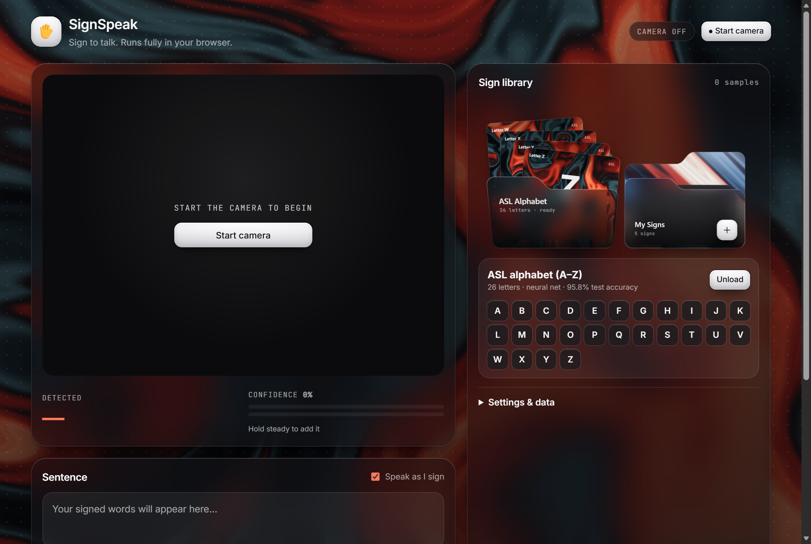
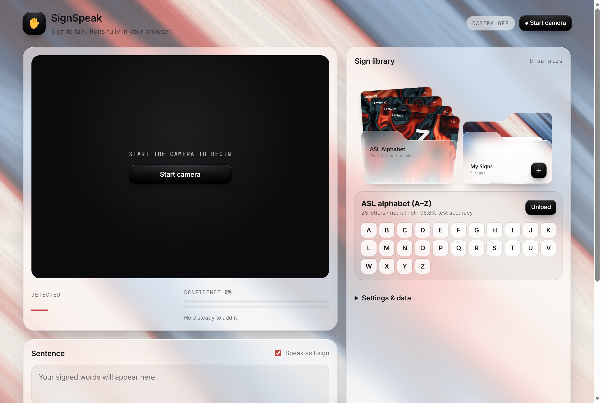
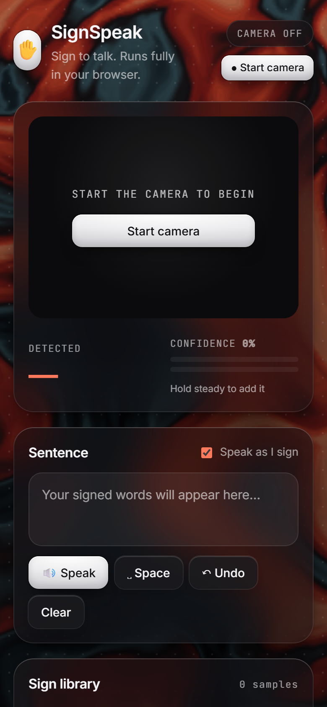
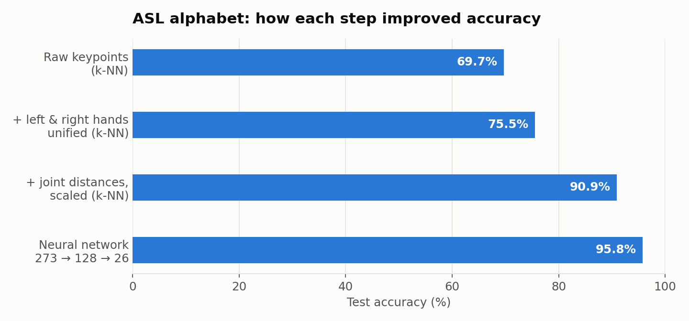
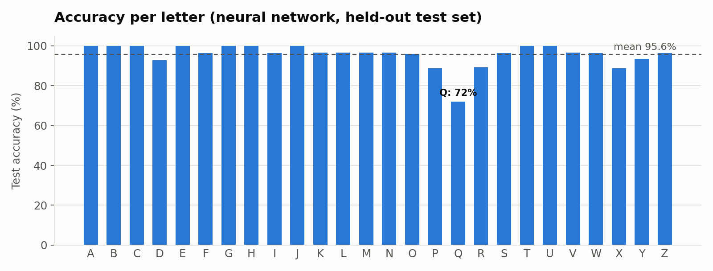
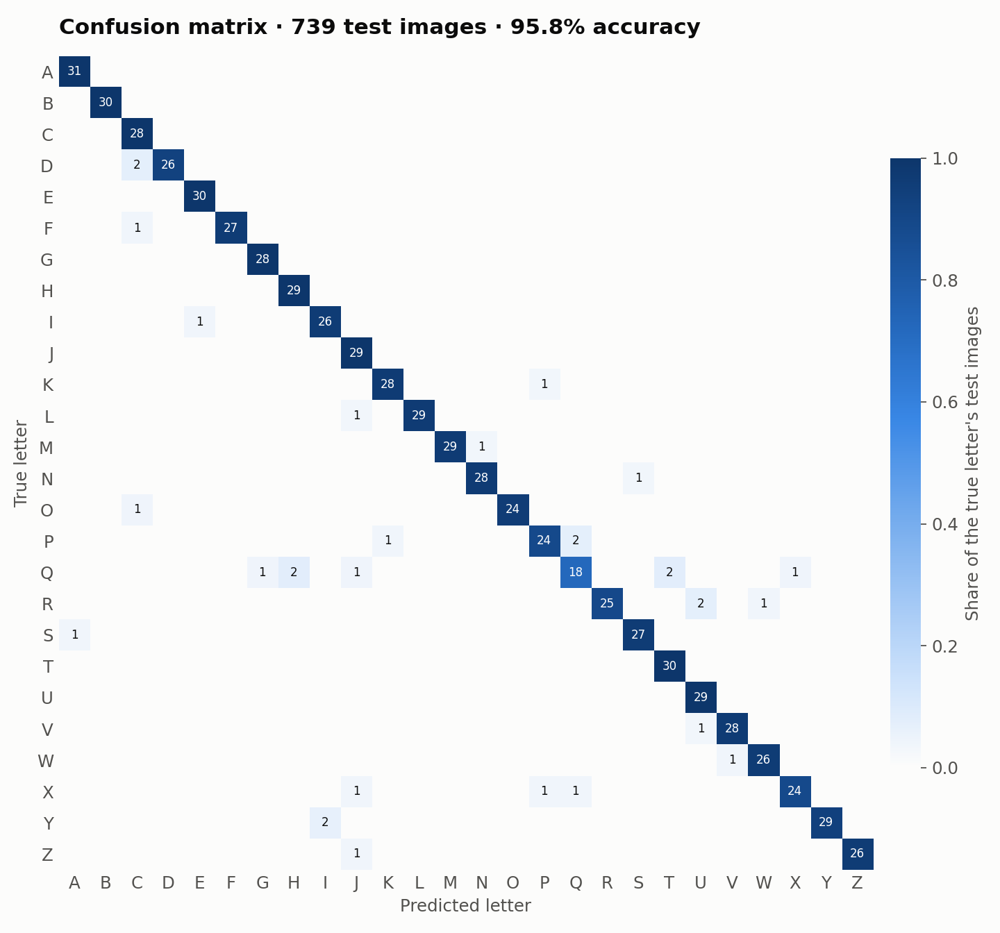
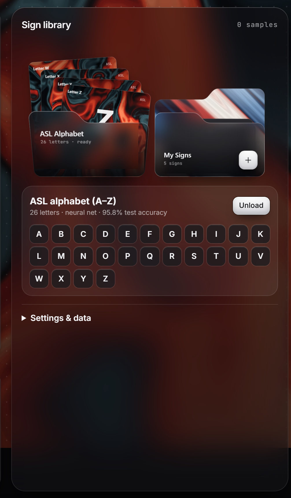
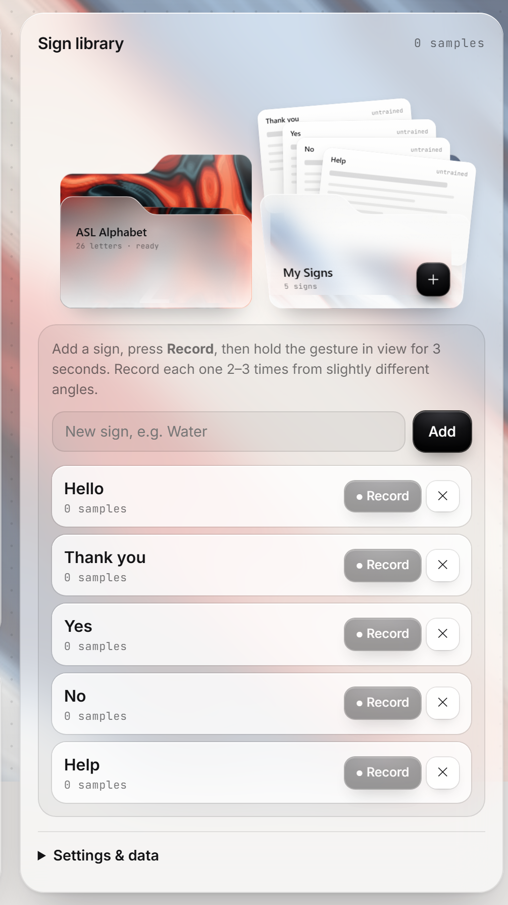

# SignSpeak ✋ → 🔊

Real-time sign-to-speech in the browser. Teach it any sign in about 3 seconds, then sign to build sentences that get spoken aloud. No server, no API keys, and video never leaves the device.



<p>
  
  
</p>

## Results

### ASL alphabet model: 95.8% test accuracy



| Step | Test accuracy |
|---|---|
| Raw keypoints, k-NN | 69.7% |
| + left & right hands unified, k-NN | 75.5% |
| + pairwise joint distances, scaled, k-NN | 90.9% |
| **Neural network (273 → 128 → 26)** | **95.8%** |

Evaluated on a held-out, stratified 20% test split (739 images). On horizontally mirrored photos, which simulate the other hand, it scores 98%.



Q is the hardest letter (72%). It gets confused with G, H and T, which have similar hand shapes. Every other letter scores 89% or higher.

<details>
<summary>Confusion matrix</summary>



</details>

Full per-letter precision, recall and F1: [`results/training_report.txt`](results/training_report.txt).
Regenerate everything with `python tools/make_report.py`.

> **Caveat:** many dataset photos are frames from the same few videos, so neighbouring frames can land in both
> the training and test sets. Real-world webcam accuracy will be lower than these numbers.

### The sign library

<p>
  
  
</p>

## Run it
Full setup on a fresh machine: [SETUP.md](SETUP.md).
```bash
python -m http.server 8080
```
Open http://localhost:8080 and click **Start camera** (the camera only works on localhost or https).

## Demo flow (judges)
1. Start the camera. The hand skeleton appears live.
2. Click **Record** on "Hello" and hold the sign for 3 s. Do the same for "Thank you", "Yes" and "Help" (record each 2–3 times).
3. Sign "Hello" → "Help". Words appear and are spoken.
4. Add a new custom sign live from a judge's suggestion. This is the wow moment.
5. Export the model JSON to show that it's portable.

## ASL alphabet model (pretrained)
- Data: the Hugging Face dataset `Marxulia/asl_sign_languages_alphabets_v03` (photos of the letters A–Z). I used 180 photos per letter, and MediaPipe found a hand in 3,694 of them.
- Features: 63 normalised keypoints, mirrored so left and right hands look the same, plus 210 pairwise joint distances (273 in total).
- Model: an MLP with one hidden layer (273 → 128 ReLU → 26), trained with scikit-learn and exported to `asl-model.json` (0.33 MB). It runs in plain JS in the browser.
- Results: **95.8% test accuracy** (a k-NN baseline gets 90.9%, raw keypoints alone 69.7%). See [Results](#results).
- To rebuild: run `python tools/download_dataset.py`, then `python tools/unpack_dataset.py`, then `python tools/build_server.py`, open `http://localhost:8081/tools/build.html?per=180`, and finally run `python tools/train_asl.py`.

## How it works (the AI/ML part)
- **MediaPipe Hand Landmarker** (CNN-based) gives 21 3D keypoints per hand, for 2 hands.
- **Feature engineering:** the keypoints are centred on the wrist and scale-normalised, which makes them invariant to position and distance. That gives a 126-dim vector.
- **k-NN classifier** with a distance threshold rejects unknown gestures. Few-shot learning, with instant training.
- **Temporal smoothing:** a sign must stay stable for N frames before it's committed, which avoids flicker.
- **Web Speech API** handles text-to-speech.

## Pitch points
- Problem: there are millions of Deaf and hard-of-hearing people, and too few interpreters. Sign languages also vary by region (ISL vs ASL), so a fixed model doesn't fit everyone.
- Solution: a personalised, few-shot model that anyone can train for their own signs, offline, for free.
- Future scope: LSTM/Transformer over landmark sequences for motion signs, ISL dataset pretraining, speech→sign reverse mode, mobile PWA.

## Tips
- Good lighting, plain background, whole hand in frame.
- If it confuses two signs, record more samples or lower **Max match distance** in Settings.
- Data is saved in the browser (localStorage); use Export/Import to move it between machines.
